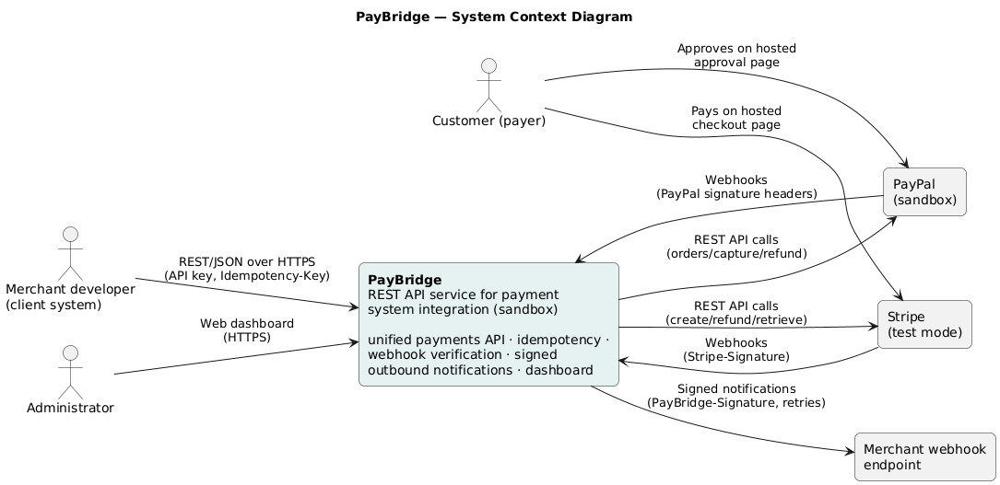
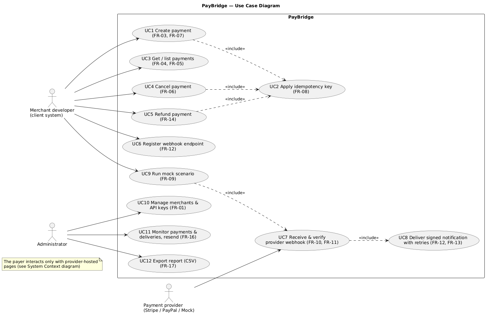
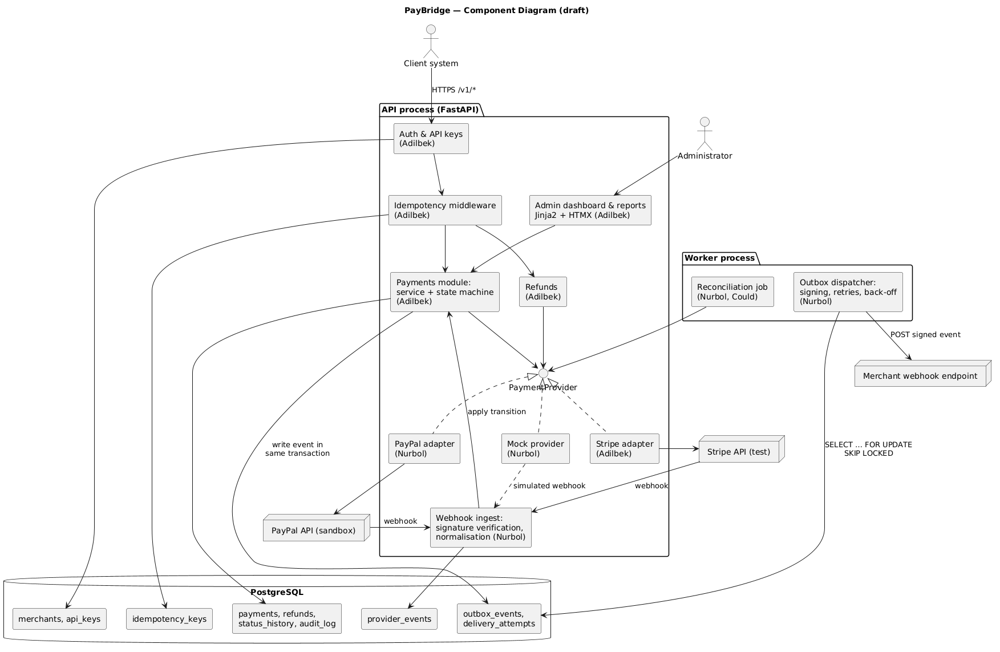
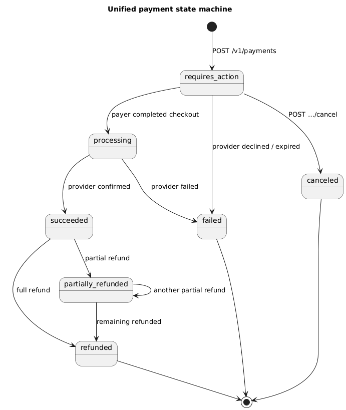
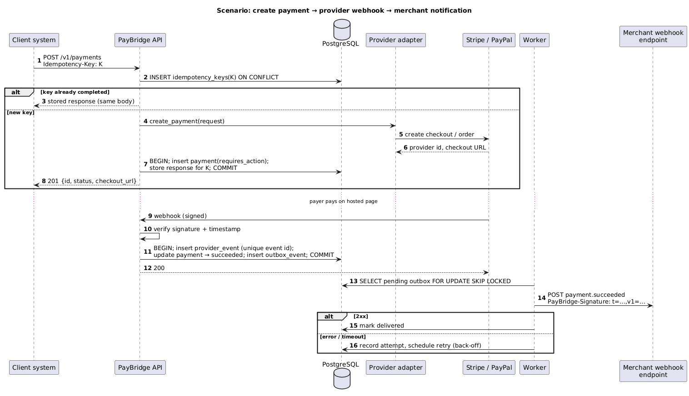
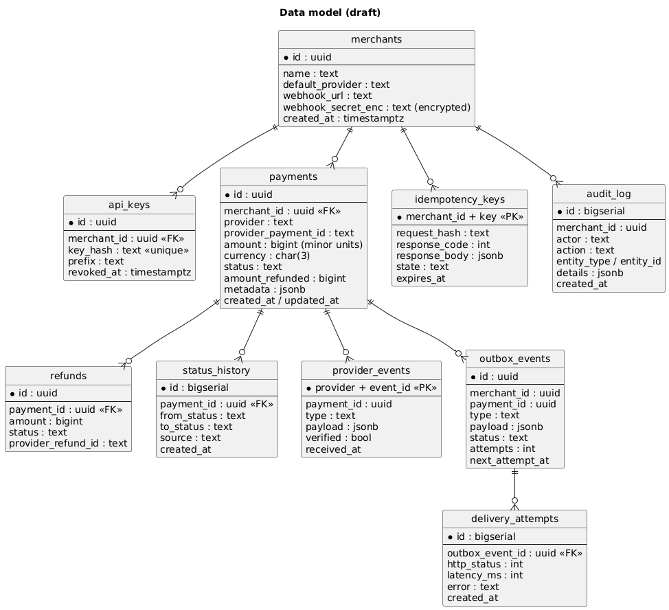

# 7. Architecture and Diagrams

All diagrams are kept as editable PlantUML sources in `diagrams/src/*.puml` and exported to
PNG/SVG in `diagrams/export/`. To regenerate: `make diagrams` (requires Java) or open the
`.puml` file in the PlantUML plugin of VS Code / IntelliJ, or at plantuml.com.

## 7.1 Architectural overview

PayBridge is a **modular monolith** with **two processes** sharing one PostgreSQL database
(ADR-001):

1. **API process** (FastAPI, Uvicorn) — serves the REST API `/v1/*`, inbound provider
   webhooks `/webhooks/{provider}`, and the admin dashboard `/admin/*`.
2. **Worker process** — delivers outbound notifications from the outbox table with retries,
   and (optionally) runs the reconciliation job.

Main architectural principles:

| Principle | How it is applied | Related requirements |
|---|---|---|
| Ports and adapters | The payment module depends only on the `PaymentProvider` interface; Stripe, PayPal and Mock are adapters | FR-07, NFR-05 |
| Single source of truth | The payment status is changed only through the state machine; every change is written to `status_history` | FR-11, FR-15 |
| Idempotent writes | `Idempotency-Key` stored with a unique constraint `(merchant_id, key)` and a hash of the request body | FR-08, NFR-02 |
| Transactional outbox | Status change and outbound event are committed in one DB transaction; the worker delivers at-least-once | FR-12, FR-13, NFR-02, NFR-04 |
| Verify, then trust | Provider webhooks are verified (signature + timestamp) before any state change; duplicates are rejected by `(provider, event_id)` primary key | FR-10, FR-11, NFR-03 |
| No card data | Payers enter card data only on provider-hosted pages | NFR-03, [G5] |

## 7.2 System context diagram

PayBridge sits between client systems and payment providers. Payers never interact with
PayBridge directly — only with provider-hosted pages.

## 7.3 Use case diagram

Each use case references the functional requirements it implements (Section 6).

## 7.4 Component diagram (draft)

| Component | Responsibility | Owner |
|---|---|---|
| Auth & API keys | Bearer-key authentication, merchant scoping | Adilbek |
| Idempotency middleware | Reserve key, compare request hash, replay stored response | Adilbek |
| Payments module | Create/get/list/cancel; state machine; status history | Adilbek |
| Refunds | Refund rules and calls through the provider interface | Adilbek |
| Admin dashboard & reports | Payment list, timeline, delivery log, resend, CSV | Adilbek |
| Stripe adapter | Checkout Session / PaymentIntent, refunds, status mapping | Adilbek |
| PayPal adapter | Orders v2 create/capture, refunds, status mapping | Nurbol |
| Mock provider | Deterministic scenarios and simulated webhooks | Nurbol |
| Webhook ingest | Signature verification, de-duplication, normalisation | Nurbol |
| Outbox dispatcher (worker) | HMAC signing, delivery, exponential back-off, delivery log | Nurbol |
| Reconciliation job | Polling fallback for stuck payments (Could) | Nurbol |

## 7.5 Supporting diagrams

**Payment state machine** — the only allowed status transitions (FR-11):

**Key scenario** — create payment, provider webhook, merchant notification:

**Data model (draft):**

## 7.6 Consistency check (requirements ↔ components ↔ data ↔ scenarios)

| Requirement | Use case | Component | Tables | Scenario / diagram |
|---|---|---|---|---|
| FR-01, FR-02 | UC10 | Auth & API keys | merchants, api_keys | — |
| FR-03, FR-07 | UC1 | Payments, adapters | payments | Sequence steps 1–8 |
| FR-08 | UC2 | Idempotency middleware | idempotency_keys | Sequence steps 2–3 |
| FR-09 | UC9 | Mock provider | payments, provider_events | — |
| FR-10, FR-11 | UC7 | Webhook ingest, Payments | provider_events, status_history | Sequence steps 9–12, state machine |
| FR-12, FR-13 | UC8 | Outbox dispatcher | outbox_events, delivery_attempts | Sequence steps 13–16 |
| FR-14 | UC5 | Refunds | refunds, payments | State machine |
| FR-15 | — | Payments | status_history, audit_log | — |
| FR-16, FR-17 | UC11, UC12 | Admin dashboard | all (read) | — |

## 7.7 Architecture decision records

| ADR | Decision |
|---|---|
| [ADR-001](adr/ADR-001-modular-monolith.md) | Modular monolith + worker instead of microservices |
| [ADR-002](adr/ADR-002-fastapi-postgresql.md) | Python/FastAPI and PostgreSQL |
| [ADR-003](adr/ADR-003-transactional-outbox.md) | Transactional outbox for outbound webhooks |
